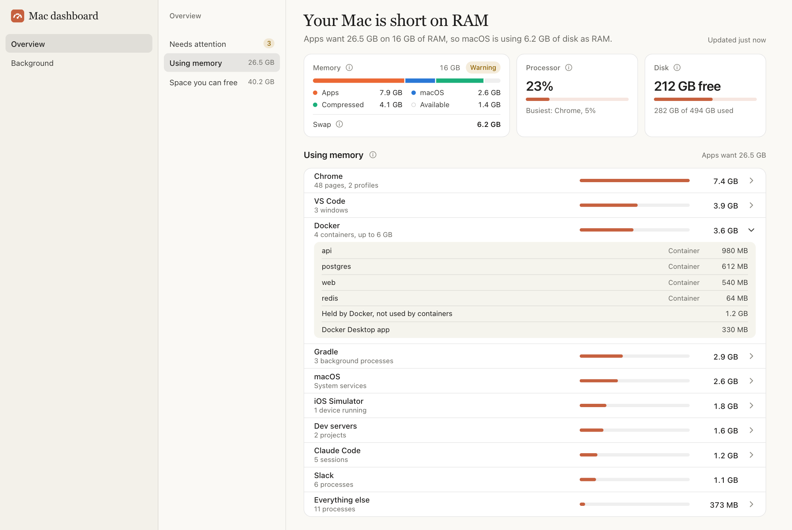

<div align="center">

# mac-dashboard

**See what is slowing down your Mac.**

A local dashboard for your Mac's RAM, swap, processor and disk. It groups hundreds of processes into the apps you know, and tells you in plain words when something is too much and what to close.

[](https://github.com/DevKazonovic/mac-dashboard/actions/workflows/ci.yml)
[](LICENSE)
[](https://nodejs.org)


<picture>
  <source media="(prefers-color-scheme: dark)" srcset="docs/screenshot-dark.png">
  
</picture>

</div>

## Install

```sh
npm install -g github:DevKazonovic/mac-dashboard
mac-dashboard enable
```

That's all. `enable` opens <http://127.0.0.1:3738> and starts the dashboard by itself every time you log in, so you never run it again. You need [Node.js](https://nodejs.org) 18 or newer and [Git](https://git-scm.com).

## Why

Activity Monitor lists hundreds of processes with names like `Google Chrome Helper (Renderer)`, `Code Helper (Plugin)` and `com.apple.Virtualization.VirtualMachine`. When your Mac slows down, it doesn't tell you which app is to blame or what to do. mac-dashboard answers the three questions you actually have:

1. **Is my Mac fine?** A one-line verdict from macOS's own memory pressure: fine, short on RAM, or out of RAM.
2. **What is using my RAM?** Your apps under the names you know, with what is inside each one.
3. **What should I do?** A short list of what is too much right now, and how to fix each one.

## Usage

| Command | What it does |
| --- | --- |
| `mac-dashboard enable` | Starts it now and every time you log in. |
| `mac-dashboard disable` | Stops starting it at login, and stops it now. |
| `mac-dashboard status` | Shows whether it is running, where, and whether it starts at login. |
| `mac-dashboard start` | Runs it in the background until you stop it or log out. |
| `mac-dashboard stop` | Stops it. |
| `mac-dashboard restart` | Stops it and starts it again. |
| `mac-dashboard update` | Installs the newest version from GitHub and restarts it. |
| `mac-dashboard` | Runs it in this terminal until you press Ctrl+C. |

To try it once without installing anything, run `npx -y github:DevKazonovic/mac-dashboard`.

## Features

- **A verdict.** Your Mac is fine, short on RAM or out of RAM, with the numbers behind it in one sentence.
- **Needs attention.** A card appears only when something is too much, and says what to do:
  - an app using more than about a third of your RAM, such as a browser with heavy tabs
  - Gradle processes left idle for 20 minutes
  - a dev server still running after the terminal or window that started it closed
  - Docker holding much more memory than its containers use
  - anything using more than 80% CPU for 2 minutes
  - an app that grew fast in the last 10 minutes while memory is tight
  - a disk with less than 15% free
- **Memory, processor and disk at a glance.** How your RAM is split between apps, macOS and compressed memory, how much swap is in use, how busy the processor is, and how much disk is free.
- **Using memory.** Chrome, Brave, Edge and Arc with their page counts; VS Code, Cursor and Windsurf with their window counts; Docker with each container; Flutter, Gradle, the iOS Simulator, Claude Code and your dev servers by project. Open a row to see what is inside it.
- **Space you can free.** Caches and build folders over 300 MB, such as the Docker build cache, Xcode build data, Gradle and npm caches, measured once an hour, with how to clear each one. Nothing is deleted for you.
- **Background page.** Everything running that you can't see: Docker containers, dev servers and other programs by folder, launchd services, and apps with no Dock icon, each with its ports, how long it has run, its processor use and its memory. macOS's own services and your open apps are listed apart, so nothing is hidden.
- **One group at a time.** A small second sidebar lists each page's groups with their totals. Pick one and it fills the page, so you don't have to scroll.
- **Light and dark mode**, following your Mac.

## How it works

The dashboard keeps one `top` running and reads `ps`, `sysctl`, `vm_stat`, `df`, `lsof` and `docker` every 5 seconds. It uses about 1.5% of one processor core and 35 MB of memory. The Background page also reads `launchctl`, `lsappinfo`, `lsof` and `docker ps`, only while that page is open.

Each app's number is its memory footprint, the same number Activity Monitor shows: the memory it uses, including what macOS compressed or moved to disk for it. Adding every app's footprint gives how much memory your apps want. When that is more than your RAM, macOS compresses memory and then uses the disk as swap, and that is when your Mac feels slow. The verdict follows macOS's own memory pressure, so it says short on RAM exactly when macOS thinks so.

## Privacy and security

Everything stays on your Mac.

- It only listens on `127.0.0.1`, and rejects requests from other sites and other host names.
- It never shows a process's command line, because command lines can hold passwords and tokens. It shows the names of apps, programs, services and containers, folder names, process IDs, ports and sizes.
- It only reads. It never deletes, stops or changes your apps or files.
- It never contacts any server.

See [SECURITY.md](SECURITY.md) for details and how to report a problem.

## Options

Add options after the command, for example `mac-dashboard enable --port 4000`.

| Option | What it does |
| --- | --- |
| `--port <number>` | Use another port. The default is 3738; if it is taken, the next free one is used. |
| `--projects-dir <path>` | Also look for Flutter build folders here. `~/Projects`, `~/Developer`, `~/Code`, `~/dev`, `~/src`, `~/workspace`, `~/repos` and `~/git` are found automatically. Repeat it for several folders. |
| `--no-open` | Do not open the browser. |
| `--demo` | Show made-up data, to try the page without your own apps. |

## FAQ

**Why is my Mac slow when Activity Monitor shows free memory?**
macOS keeps RAM full on purpose and compresses memory before it runs out. The signs that RAM is really short are memory pressure and swap. The dashboard shows both, and names the apps that cause them.

**Why does Chrome use so much memory?**
Chrome runs every site in its own process, including embedded ads and videos, and pages that stay open for hours keep growing. The dashboard counts Chrome's pages and tells you how many are over 300 MB. Chrome's Task Manager, in its Window menu, shows which ones.

**Why does Docker use so much memory on a Mac?**
Docker runs a Linux virtual machine that holds on to the memory it was given, even when containers use much less. The dashboard shows both numbers, so you can lower Docker's memory limit or restart it.

**Does it work on Intel Macs?**
It is tested on Apple silicon and only uses tools that every recent version of macOS has, so it should. If something looks wrong on your Mac, please [open an issue](https://github.com/DevKazonovic/mac-dashboard/issues/new/choose).

**It stopped starting at login after I changed my Node.js version.**
The login item runs the Node.js you had when you ran `enable`. If you removed that version, for example with nvm, run `mac-dashboard enable` again.

**Where is the log?**
In `~/Library/Logs/mac-dashboard/dashboard.log`. `mac-dashboard status` prints the path.

**How do I uninstall it?**
Run `mac-dashboard disable`, then `npm uninstall -g mac-dashboard`.

## Contributing

Issues and pull requests are welcome. There is no build step and there are no dependencies: clone the repo, run `npm run dev`, and the dashboard restarts every time you save a file. [CONTRIBUTING.md](CONTRIBUTING.md) explains the rest.

## License

[MIT](LICENSE)
